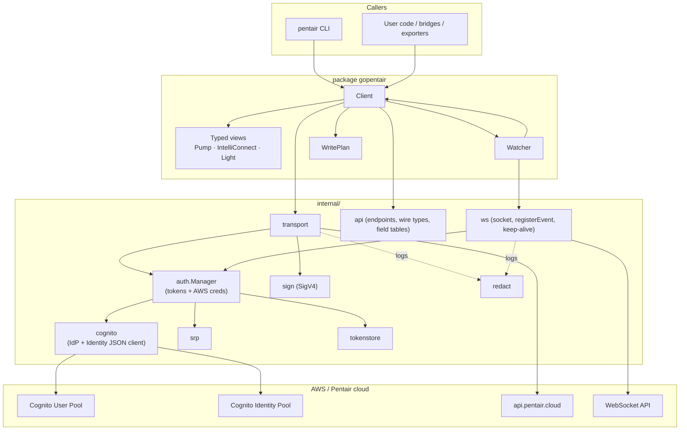
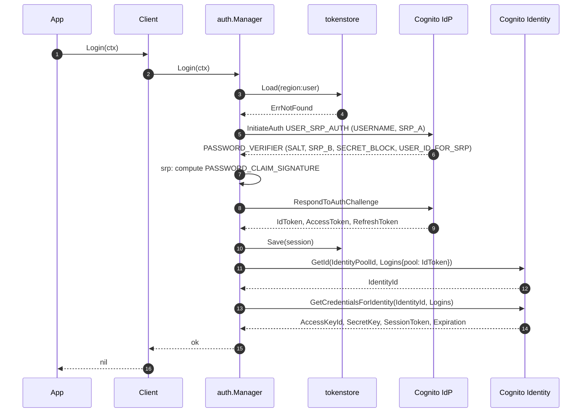
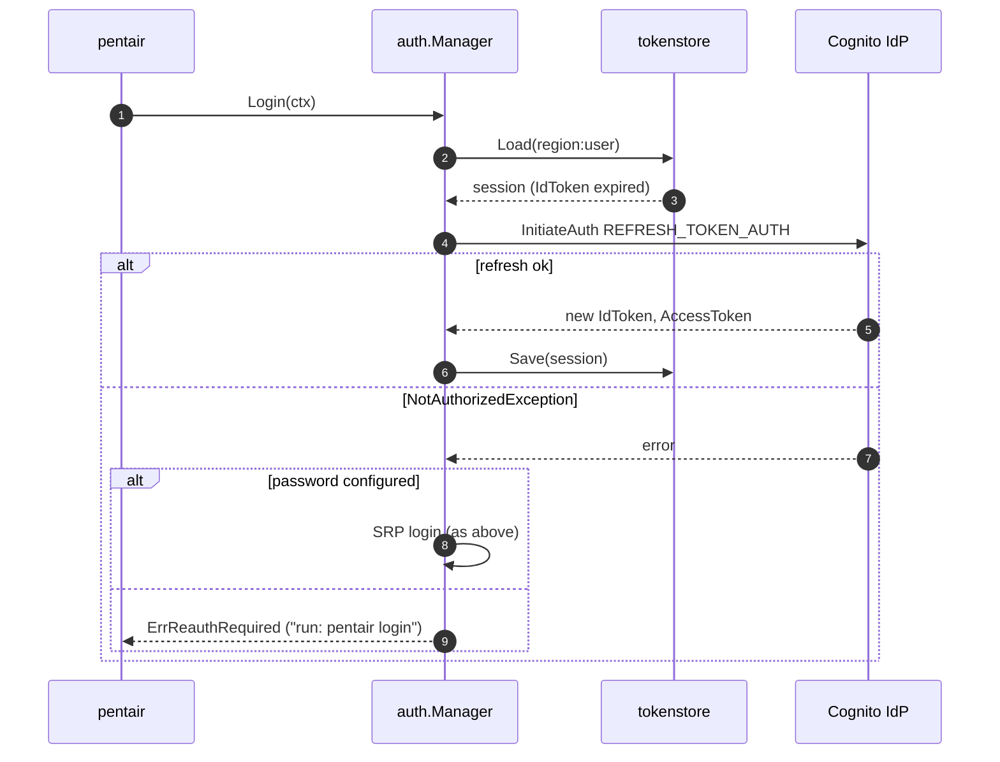
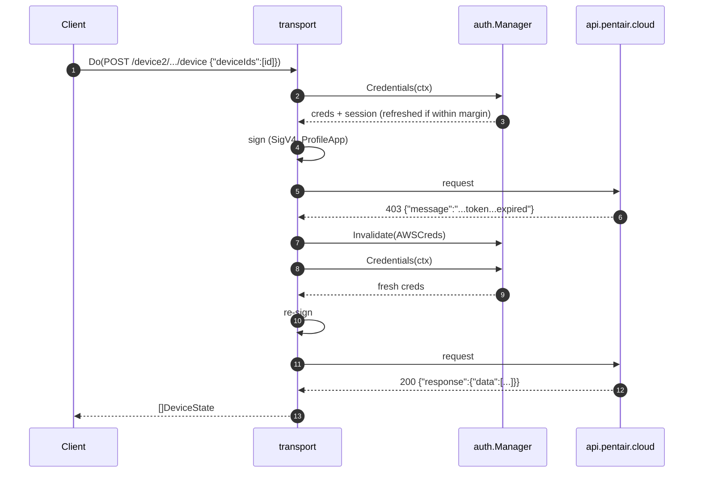
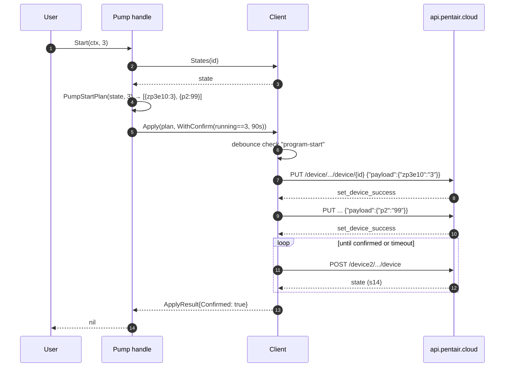
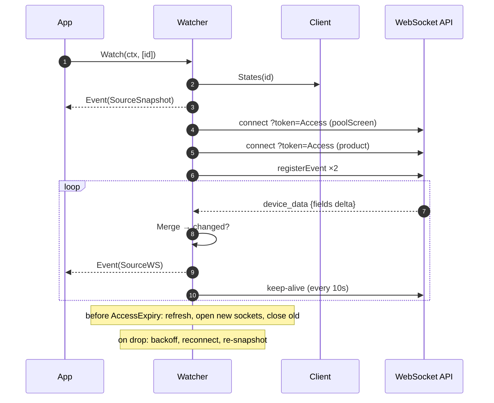
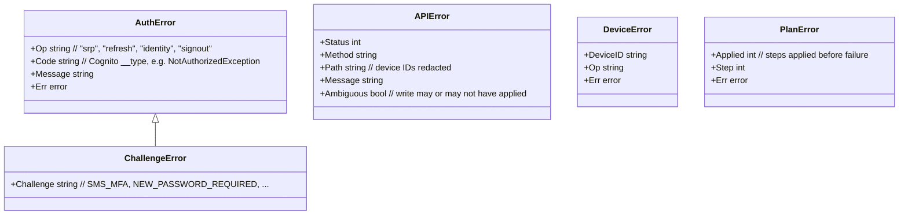

# gopentair — Design Document

A Go SDK and CLI (`pentair`) for the Pentair Home cloud API.

- Module: `github.com/emergingrobotics/gopentair`
- Package: `gopentair`
- CLI: `cmd/pentair`

See [../VISION.md](../VISION.md) for the why, and [research.md](research.md) for the reverse-engineered API this design builds on. `api-docs.md` will hold the API as confirmed against live accounts.

## Table of Contents

1. [Overview](#overview)
2. [Design Principles](#design-principles)
3. [Architecture](#architecture)
4. [Module Structure](#module-structure)
5. [Authentication](#authentication)
6. [Request Signing](#request-signing)
7. [Transport](#transport)
8. [Data Models](#data-models)
9. [Typed Device Views](#typed-device-views)
10. [Writes, Plans and Safety](#writes-plans-and-safety)
11. [Real-time: Watch](#real-time-watch)
12. [Sequence Diagrams](#sequence-diagrams)
13. [CLI Design](#cli-design)
14. [Error Handling](#error-handling)
15. [Configuration](#configuration)
16. [Logging and Redaction](#logging-and-redaction)
17. [Concurrency](#concurrency)
18. [Testing Strategy](#testing-strategy)
19. [Dependencies](#dependencies)
20. [Example Usage](#example-usage)
21. [Open Questions](#open-questions)

---

## Overview

The Pentair Home app talks to three AWS-hosted services:

| Service | Host | Auth |
|---|---|---|
| Cognito User Pool | `cognito-idp.us-west-2.amazonaws.com` | SRP with username and password, or a refresh token |
| Cognito Identity Pool | `cognito-identity.us-west-2.amazonaws.com` | IdToken in `Logins`; returns temporary AWS credentials |
| Pentair REST API (API Gateway) | `api.pentair.cloud` | SigV4 (`execute-api`) plus an `x-amz-id-token` header |
| Pentair WebSocket (API Gateway) | `g44t970cbi.execute-api.us-west-2.amazonaws.com/prod` | AccessToken in the query string and in `registerEvent` |

`gopentair` hides that chain behind one `Client`. The client offers:
- device listing and state snapshots
- raw field reads and writes
- typed views for known products
- a merged real-time event stream

---

## Design Principles

1. **Public surface in the root package; mechanics in `internal/`.** This matches `goaquatemp`. Only the root package carries API stability promises.
2. **Fields are the ground truth.** Every device is a bag of string-valued field codes. Typed views are pure decoders and encoders layered on top. They never hide the raw fields.
3. **Pure functions at the edges.** Decoding a `DeviceState` into a `PumpStatus`, or turning "start program 3" into a list of field writes, are side-effect-free functions. That makes them trivial to unit-test and reusable by `Watch` consumers.
4. **No surprise actuation.** Writes happen only when you call a write method. Write methods are never auto-retried on ambiguous failures. Every write can be previewed as a plan.
5. **Polite client.** The client enforces minimum poll intervals, collapses concurrent token refreshes into one, caches refresh tokens, and backs off on reconnect.
6. **`context.Context` everywhere.** The client is safe for concurrent use.

---

## Architecture



---

## Module Structure

```
gopentair/
├── client.go            # Client interface, NewClient, implementation
├── options.go           # functional options
├── config.go            # Config, env + YAML loading, precedence
├── device.go            # Device, DeviceState, Field, DeviceType, Profile
├── fields.go            # Field accessors: Int, Float, Scaled, Bool, Has
├── plan.go              # WritePlan, WriteStep, Apply, DryRun
├── pump.go              # IF31 view: PumpStatus, Program, DecodePump, PumpStartPlan...
├── intelliconnect.go    # PIF0 view: PoolStatus, HeaterMode, RelayState, DecodePool, plans
├── light.go             # PLC1 view: LightStatus, LightShow, DecodeLight, plans
├── watch.go             # Watcher, Event, WatchOption
├── errors.go            # error types + sentinels
├── units.go             # F<->C helpers, UTC seconds-of-day <-> time.Time
├── doc.go
├── internal/
│   ├── auth/            # Manager: Session (JWTs) + AWSCredentials, refresh logic
│   ├── cognito/         # minimal JSON client: InitiateAuth, RespondToAuthChallenge,
│   │                    #   GetId, GetCredentialsForIdentity, GlobalSignOut
│   ├── srp/             # Cognito SRP-6a math (A, M1, password-claim signature)
│   ├── tokenstore/      # Store interface; Memory, File, None
│   ├── sign/            # SigV4 signer with header profiles
│   ├── transport/       # signed HTTP, envelopes, retry policy
│   ├── api/             # endpoint constants, wire types, known field-name tables
│   ├── ws/              # WebSocket connection: register, keep-alive, read loop
│   ├── redact/          # slog handler + value scrubbers
│   └── testutil/        # fake Cognito + fake Pentair REST/WS server, fixtures
├── cmd/pentair/
│   ├── main.go          # root command, global flags, client construction
│   ├── auth.go          # login, logout, whoami
│   ├── devices.go       # devices list/info
│   ├── status.go        # status (dispatches on device type)
│   ├── fields.go        # fields, fields set, diff
│   ├── watch.go         # watch
│   ├── pump.go          # pump ...
│   ├── pool.go          # pool ...
│   ├── light.go         # light ...
│   └── output.go        # table / JSON / CSV writers
├── examples/
│   ├── status/  watch/  pump-program/  prometheus/
├── testdata/            # redacted live captures (golden fixtures)
└── docs/
    ├── DESIGN.md  research.md  api-docs.md  plan.md
```

---

## Authentication

### State

`auth.Manager` owns two independently expiring credentials:

```go
type Session struct {           // Cognito User Pool JWTs
    IDToken      string
    AccessToken  string
    RefreshToken string
    IDExpiry     time.Time      // from the JWT "exp" claim (parsed, not verified)
    AccessExpiry time.Time
    Subject      string         // JWT "sub"
}

type AWSCredentials struct {    // from Cognito Identity
    AccessKeyID  string
    SecretKey    string
    SessionToken string
    Expiry       time.Time
    ForIDToken   string         // hash of the IdToken these were minted with
}
```

### Manager behaviour

```go
type Manager interface {
    Login(ctx context.Context) error                    // resume from store, else SRP
    Session(ctx context.Context) (*Session, error)      // fresh JWTs (refresh if within margin)
    Credentials(ctx context.Context) (*AWSCredentials, *Session, error) // fresh creds + matching session
    Invalidate(what InvalidateKind)                     // force re-mint after a 401/403
    Logout(ctx context.Context, everywhere bool) error
}
```

Rules:

| Rule | Detail |
|---|---|
| Refresh margin | Refresh the JWTs when `IDExpiry - now < 5m`. Re-mint the AWS credentials when `Expiry - now < 5m` **or** `ForIDToken` no longer matches the current IdToken. |
| Single flight | One mutex-guarded refresh path. Concurrent callers wait and then share the result. |
| Refresh failure | If `REFRESH_TOKEN_AUTH` returns `NotAuthorizedException` and a password is configured, run SRP again. Otherwise return `ErrReauthRequired`. |
| Persistence | After every successful login or refresh, save the `Session` (never the password, never the AWS credentials) to the `tokenstore.Store`. |
| Logout | `Logout(false)` clears the store and memory. `Logout(true)` additionally calls `GlobalSignOut`, which also signs out the phone app. |

### SRP login

The Cognito calls are hand-written JSON POSTs (`X-Amz-Target`, `Content-Type: application/x-amz-json-1.1`), so we don't pull in the AWS SDK for Cognito.

1. `InitiateAuth` with `USER_SRP_AUTH`, `USERNAME`, `SRP_A` returns a `PASSWORD_VERIFIER` challenge (`SALT`, `SRP_B`, `SECRET_BLOCK`, `USER_ID_FOR_SRP`).
2. `internal/srp` computes `PASSWORD_CLAIM_SIGNATURE` over `poolName ‖ userIdForSRP ‖ secretBlock ‖ timestamp`, using the timestamp format `Mon Jan 2 15:04:05 UTC 2006`.
3. `RespondToAuthChallenge` returns `AuthenticationResult`.

Other challenges (`SMS_MFA`, `SOFTWARE_TOKEN_MFA`, `NEW_PASSWORD_REQUIRED`, `DEVICE_SRP_AUTH`) return a typed `*ChallengeError`. Version 1 doesn't support them, but the type leaves room to add a callback later (`WithChallengeHandler`).

### Region profiles

```go
type Region struct {
    Name, AWSRegion, UserPoolID, ClientID, IdentityPoolID string
}
var RegionUS = Region{"us", "us-west-2", "us-west-2_lbiduhSwD",
    "3de110o697faq7avdchtf07h4v", "us-west-2:6f950f85-af44-43d9-b690-a431f753e9aa"}
var RegionEU = Region{"eu", "eu-west-1", "eu-west-1_rsBGJFuRd", "", ""} // experimental; IDs TBD
```

The constants live in `internal/api` and the root package re-exports them. `WithRegion(r)` accepts a custom `Region` so users can recover on their own if Pentair rotates the IDs.

### Token store

```go
type Store interface {
    Load(ctx context.Context, key string) (*auth.Session, error) // ErrNotFound if absent
    Save(ctx context.Context, key string, s *auth.Session) error
    Delete(ctx context.Context, key string) error
}
```

- The key is `region + ":" + lower(username)`, so one file can hold several accounts.
- `File` writes `~/.config/pentair/tokens.json`. It writes atomically (temp file and rename), uses mode `0600`, and refuses to read the file if it is group- or world-readable.
- `Memory` is the library default and `File` is the CLI default. `None` disables caching.

---

## Request Signing

`internal/sign` implements AWS SigV4 itself, in about 100 lines, using only the standard library. Owning the code gives exact control over which headers get signed, and the app's header set is unusual.

```go
type Profile struct {
    Name          string
    SignedHeaders []string       // canonical, lower-case
    Extra         func(r *http.Request) // set app-mimicking headers before signing
}

var ProfileStandard = Profile{ // boto3-equivalent; what pypentair uses
    SignedHeaders: []string{"host", "x-amz-date", "x-amz-id-token", "x-amz-security-token"},
}
var ProfileApp = Profile{      // byte-for-byte what app v4.2.x sends
    SignedHeaders: []string{"host", "iseuropeanuser", "x-amz-date",
        "x-amz-id-token", "x-amz-security-token", "x-pha-apptype"},
}

func Sign(r *http.Request, body []byte, creds Credentials, region, service string,
          p Profile, now time.Time) error
```

- Service: `execute-api`. Region: from the `Region` profile.
- The payload hash is the SHA-256 of the body (an empty body gives `e3b0c442…`).
- `content-type` and `content-length` are **not** signed.
- `ProfileApp` is the default. `x-pha-apptype` is set to `pool` on reads and to the empty string on device PUTs, per captures. Milestone 1 settles whether `ProfileStandard` is accepted everywhere. If it is, the app profile stays optional.
- The signer is tested against the published AWS SigV4 test suite vectors, plus a captured Pentair request that has been redacted.

---

## Transport

```go
type Request struct {
    Method  string
    Path    string          // "/device2/device2-service/user/device"
    Body    any             // JSON-encoded if non-nil
    Kind    Kind            // Read | Write   (drives retry policy + apptype)
    Envelope Envelope       // V1Data | V2Response
}
func (t *Transport) Do(ctx context.Context, req Request, out any) error
```

### Envelopes

| Endpoint family | Shape | Decoded into |
|---|---|---|
| `device/device-service`, `user/user-service` | `{"data": <T>}` | `out` = `<T>` |
| `device2/device2-service` | `{"response": {"data": <T>}}` | `out` = `<T>` |
| Write ack | `{"data": {"code": "set_device_success", ...}}` | checked; otherwise `ErrNotAcknowledged` |

An unknown envelope shape is an `*APIError`. It never comes back as a zero value.

### Retry policy

| Condition | Read | Write |
|---|---|---|
| 401/403 with an expired-token message | invalidate creds, re-sign, retry once | same (the request was rejected before reaching the device) |
| 429, 502, 503, 504 | exponential backoff with jitter, up to `RetryCount` (default 3) | **no retry**: return `*APIError{Ambiguous: true}` |
| Network error before the request is written | retry | retry |
| Timeout or reset after the request is sent | retry | **no retry**: ambiguous |
| Other 4xx | return `*APIError` | return `*APIError` |

Writes set field values, which is *mostly* idempotent. Some fields are one-shot triggers, though, such as `icd2`/`icd3` boost and `d1=5/6` hold/recall. A blind retry could therefore actuate twice. Callers that want "make sure" semantics use `WithConfirm` (see below).

Default headers: `user-agent` is `gopentair/<version>`, and `WithUserAgent` can override it, for example with the app's `aws-amplify/4.3.10 react-native`. Bodies use `content-type: application/json; charset=UTF-8`.

---

## Data Models

```go
type DeviceType string
const (
    TypeIntelliFlo3    DeviceType = "IF31"
    TypeIntelliConnect DeviceType = "PIF0"
    TypeColorSync      DeviceType = "PLC1"
    TypeIntelliCenter  DeviceType = "ICT1" // listed, unmapped
    TypeChemCheck      DeviceType = "WQM1" // listed, unmapped
)

type Device struct {
    ID        string
    Type      DeviceType
    Product   string            // "pname"
    Nickname  string            // productInfo.nickName
    Status    string            // "ACTIVE", ...
    ARN       string
    Components map[string]any   // device2 "devices" map, kept raw
    Raw       json.RawMessage   // full listing record
}

type Field struct {
    Code  string
    Name  string                // cloud-provided, or from api.FieldNames[type]
    Value string                // always a string on the wire
    Min, Max string
    Raw   json.RawMessage
}

type DeviceState struct {
    DeviceID  string
    Type      DeviceType
    Online    bool
    Alarm     bool
    FWVersion string
    Fields    map[string]Field
    UpdatedAt time.Time         // time of last snapshot or merged delta
    Raw       json.RawMessage
}

// Accessors return (value, ok); ok=false if absent or unparsable.
func (s DeviceState) Str(code string) (string, bool)
func (s DeviceState) Int(code string) (int64, bool)
func (s DeviceState) Scaled(code string, div float64) (float64, bool)
func (s DeviceState) Bool(code string) (bool, bool)    // "1"/"0"
func (s DeviceState) Clone() DeviceState
func (s *DeviceState) Merge(delta map[string]Field) (changed []string)
```

Typed fields that may be missing are pointers (`*float64`). An absent field never shows up as zero, because a pump that reports 0 W must not look the same as a pump with no power reading.

---

## Typed Device Views

Each view has three parts:
1. a pure **decoder**: `DeviceState` in, a status struct out
2. pure **plan builders**: an intent in, a `WritePlan` out
3. a thin **handle** that binds a client and a device ID for convenience

### IF31: IntelliFlo 3 pump

```go
type PumpStatus struct {
    PowerW       *int
    SpeedPct     *float64     // s19 / 10
    FlowGPM      *float64     // s26 / 10
    PressurePSI  *float64     // s17 / 100  (confirm live; pypentair uses /10)
    AlarmBits    *uint32      // s20
    ActiveProgram *int        // s14 + 1, or nil if none
    RemainingTime *time.Duration
    RSSI         *int
    Programs     []Program
}
type ProgramType int // 0 Schedule, 1 Interval, 2 Manual
type Program struct {
    Number  int              // 1..14
    Name    string           // zpNe2
    Type    ProgramType      // zpNe5
    Start   *time.Duration   // zpNe6
    Duration *time.Duration  // zpNe7
    Days    *Weekdays        // zpNe8
    Enabled bool             // zpNe10
    Running bool
}
func DecodePump(s DeviceState) PumpStatus
func PumpStartPlan(s DeviceState, program int) (WritePlan, error) // [{zpNe10:3}, {p2:99}]
func PumpStopPlan(s DeviceState, program int) (WritePlan, error)  // [{zpNe10:2}, {p2:N-1}]
```

`PumpStartPlan` returns a plan **without a stop step** when another program is already running. Switching programs directly avoids a hard restart of about 30 s.

### PIF0: IntelliConnect

```go
type RelayState int // ra0: 0 OffNoSched, 1 OnNoSched, 2 OffSched, 3 OnSched, 4 TimerDoneSched
type HeaterMode int // htd1: 0 Off, 1 AutoIdle, 2 SchedRunning?, 3 Heating, 4 SchedWillRun?
type PoolStatus struct {
    PumpRunning    bool           // ra4 > 0   (physical truth)
    PumpPowerW     *int           // ra4
    Relay          RelayState     // ra0       (intent)
    ScheduleOn     bool           // ra0 in {2,3,4}
    ScheduleStart, ScheduleStop *ClockUTC // ra1, ra2 (seconds-of-day UTC)
    TimerRemaining *time.Duration // ras0
    WaterTempF, AirTempF *int     // t0, t1
    Heater         HeaterMode
    HeaterSetpointF *float64      // htd2 / 10
    HeaterCooldown *time.Duration // htd14
    Chlor          *ChlorStatus   // nil if no salt cell fields present
}
func DecodePool(s DeviceState) PoolStatus
func PoolPumpPlan(s DeviceState, on bool) WritePlan          // preserves schedule bit
func PoolSchedulePlan(s DeviceState, enabled bool) WritePlan // preserves override bit
func PoolScheduleTimesPlan(start, stop time.Time) WritePlan  // local -> UTC seconds-of-day
func HeaterPlan(mode HeaterMode, setpointF *float64) (WritePlan, error) // OFF writes htd1=0 + htd13
func ChlorinePlan(pct int) (WritePlan, error)                // 0..100
```

### PLC1: Color Sync

```go
type LightShow int // d1: 0 Red..4 Blue, 7 SAm..13 Royal ; 5 Hold, 6 Recall are commands
type LightStatus struct { On bool; Show *LightShow }
func DecodeLight(s DeviceState) LightStatus
func LightPowerPlan(on bool) WritePlan
func LightShowPlan(show LightShow) WritePlan
func LightHoldPlan() WritePlan
func LightRecallPlan() WritePlan
func ParseLightShow(name string) (LightShow, error) // case-insensitive names
```

### Field-name tables

`internal/api/fields_<type>.go` holds `map[string]string` code-to-name tables, seeded from research and grown from live data. The tables are used for the CLI `fields --names` option and for debugging. Decoders never depend on them.

---

## Writes, Plans and Safety

```go
type WriteStep struct {
    Fields map[string]string
    Note   string            // human description, shown in --dry-run
    After  time.Duration     // optional delay before this step
}
type WritePlan struct {
    DeviceID string
    Steps    []WriteStep
    Debounce DebounceKey     // e.g. "program-start"; "" for none
}

func (c *client) Apply(ctx context.Context, p WritePlan, opts ...ApplyOption) (*ApplyResult, error)
```

- **Dry run:** `WithDryRun()` returns the plan rendered as steps without sending anything. The CLI's `--dry-run` uses this.
- **Debounce:** a per-device, per-key limiter (`program-start` defaults to 30 s) returns `ErrRateLimited` along with the remaining wait time. `WithDebounce(map[DebounceKey]time.Duration)` tunes it.
- **Confirm:** `WithConfirm(pred func(DeviceState) bool, timeout)` waits after the last step, via a Watch delta or a 5 s REST poll, until the predicate holds. If it doesn't, it returns `ErrNotConfirmed`, carrying the last state. Typed handles supply sensible predicates: pump on means `ra4 > 0` within 90 s, and light show means `d1 == show`.
- **Partial failure:** if step *k* fails, `ApplyResult` reports which steps were applied. The client doesn't attempt compensating writes.
- `SetFields(ctx, id, fields)` is sugar for a one-step plan.

---

## Real-time: Watch

```go
type Event struct {
    DeviceID string
    Changed  []string          // field codes changed in this event
    State    DeviceState       // full merged snapshot (a copy)
    Source   Source            // SourceSnapshot | SourceWS | SourcePoll
    At       time.Time
}

type WatchOption func(*watchConfig)
func WithScreens(screens ...string) WatchOption     // default: "poolScreen", "product"
func WithPollFallback(d time.Duration) WatchOption  // default 60s, min 30s; 0 disables
func WithAppUse(enabled bool) WatchOption           // default true when "product" is watched
func WithFieldFilter(codes ...string) WatchOption   // only emit when these change

func (c *client) Watch(ctx context.Context, ids []string, opts ...WatchOption) (<-chan Event, error)
```

### Behaviour

1. Take an initial REST snapshot with `States(ids...)`. Emit one `SourceSnapshot` event per device.
2. Open one `ws.Conn` per screen: `wss://…/prod?token=<AccessToken>`.
3. On connect, send one `registerEvent` per device: `{"action":"registerEvent","body":{"device_ids":id,"active_screen":screen,"token":access}}`.
4. Send the text frame `keep-alive` every 10 s (configurable; the app uses about 1 s). Use WebSocket ping/pong as well.
5. When `appuse` is on, PUT `{"appuse":"1"}` per device every 60 s. These go through the transport without debounce and are excluded from confirm logic.
6. For each `{"event_type":"device_data","deviceId","data":{"fields"}}` frame, `Merge` it into the per-device state. If anything changed (and the filter passes), emit `SourceWS`.
7. The poll fallback ticker calls `States`, diffs the result against the merged state, and emits `SourcePoll` for any drift.
8. **Reconnect:** exponential backoff from 1 s to 30 s with jitter. After a reconnect, take a fresh snapshot to cover any gap.
9. **Token rotation:** the AccessToken is fixed in the URL. Shortly before `AccessExpiry`, the watcher refreshes the session and reconnects proactively, make-before-break, so no deltas are lost.
10. The channel is buffered (64). If the consumer falls behind, events for a device coalesce: the latest state wins and the `Changed` sets are unioned. Slow consumers never block the socket reader.
11. Cancelling `ctx` closes the sockets and the channel.

---

## Sequence Diagrams

### First login (SRP) and token caching



### Resume from cache (later CLI runs)



### Signed read with expired-token recovery



### Start a pump program with confirm



### Watch



---

## CLI Design

### Command tree

```
pentair
├── login                       # SRP (prompts for password if not in env/config), caches session
├── logout [--everywhere]       # local clear; --everywhere = GlobalSignOut (confirm prompt)
├── whoami                      # profile
├── devices
│   ├── list
│   └── info [--device ID]      # listing record + component map
├── status [--device ID]        # typed summary by device type; raw fields otherwise
├── fields [--device ID] [--filter PREFIX] [--names] [--changed-since DUR]
│   └── set --device ID CODE=VALUE ... [--dry-run] [--yes]
├── diff [--device ID] [--wait DUR]   # snapshot, wait (Enter or DUR), snapshot, print changes
├── watch [--device ID|--all] [--screen S]... [--fields a,b] [--ndjson]
├── pump    status | programs | start <n|name> | stop <n|name>
├── pool    status | pump on|off | schedule [--enable|--disable] [--start HH:MM --stop HH:MM]
│           | heater off|heat [--setpoint F] | chlorine PCT
├── light   status | on | off | show NAME | hold | recall | shows
└── version
```

### Global flags

| Flag | Purpose |
|---|---|
| `--device ID` | target device; resolution order: flag, `PENTAIR_DEFAULT_DEVICE`, config, the only device of the matching type |
| `--json` / `--csv` | output format (the default is a table); `watch` also has `--ndjson` |
| `--dry-run` | print the write plan without sending it |
| `--yes` | skip the confirmation prompt for raw `fields set` and `logout --everywhere` |
| `--no-confirm` | skip the post-write confirm wait |
| `--config PATH`, `--token-file PATH` | override locations |
| `--debug` | redacted request/response logging to stderr |
| `--units f\|c\|both` | temperature display (default `both`) |

### Behaviour

- Typed subcommands check the device type. Running `pump start` against a `PIF0` device fails with a clear error pointing to `pool`.
- Raw `fields set` prompts for confirmation unless `--yes` is given or stdin isn't a TTY with `--yes` set. Typed commands don't prompt.
- Machine output (`--json`) always includes both the decoded view and the raw `fields` map.
- Exit codes:

  | Code | Meaning |
  |---|---|
  | 0 | ok |
  | 1 | generic error |
  | 2 | usage |
  | 3 | auth / re-login needed |
  | 4 | device offline |
  | 5 | write not acknowledged or not confirmed |
  | 6 | rate-limited |

- The client is constructed in `main.go` behind an interface, so command tests inject a mock client, as `goaquatemp`'s `mockClient` does.

---

## Error Handling



Sentinels (use `errors.Is`):

| Sentinel | Meaning |
|---|---|
| `ErrReauthRequired` | no usable session and no password |
| `ErrInvalidCredentials` | wrong username or password |
| `ErrDeviceNotFound` | no such device on the account |
| `ErrDeviceOffline` | device reports `online: false` |
| `ErrUnsupportedDevice` | a typed view was used on the wrong device type |
| `ErrNotAcknowledged` | write response code was not `set_device_success` |
| `ErrNotConfirmed` | write was acknowledged but state didn't match before timeout |
| `ErrRateLimited` | blocked by the client-side debounce |
| `ErrInvalidValue` | argument out of range (e.g. chlorine > 100) |

Error strings never include tokens, credentials, device IDs or ARNs.

---

## Configuration

Precedence, highest first:
1. functional options
2. environment variables
3. config file
4. defaults

```yaml
# ~/.config/pentair/config.yaml
username: "you@example.com"
password: ""                 # prefer PENTAIR_PASSWORD or `pentair login` prompt
region: "us"                 # us | eu
default_device: ""
token_file: "~/.config/pentair/tokens.json"   # "none" disables
timeout: "15s"
retry_count: 3
poll_interval: "60s"         # floor 30s
sign_profile: "app"          # app | standard
user_agent: ""
debug: false
devices:                     # optional friendly aliases usable with --device
  pump: "<device id>"
  lights: "<device id>"
```

| Variable | Default |
|---|---|
| `PENTAIR_USERNAME` / `PENTAIR_PASSWORD` | – |
| `PENTAIR_REGION` | `us` |
| `PENTAIR_DEFAULT_DEVICE` | – |
| `PENTAIR_CONFIG` | `~/.config/pentair/config.yaml` |
| `PENTAIR_TOKEN_FILE` | `~/.config/pentair/tokens.json` |
| `PENTAIR_DEBUG` | `false` |

Options: `WithUsername`, `WithPassword`, `WithRegion`, `WithTokenStore`, `WithHTTPClient`, `WithTimeout`, `WithRetryCount`, `WithSignProfile`, `WithUserAgent`, `WithLogger(*slog.Logger)`, `WithClock` (for tests), `WithBaseURLs(rest, ws, idp, identity)` (for tests or the fake server), `WithConfig`, `WithEnvConfig`, `WithConfigFile`.

Unlike `goaquatemp`, `WithConfigFile` returns load errors. They come out of `NewClient` instead of being silently ignored.

---

## Logging and Redaction

- The client uses `log/slog`. It logs nothing unless a logger is provided or `--debug` is set.
- `internal/redact` provides an `slog.Handler` wrapper and JSON scrubbers. It always masks:
  - `Authorization`, `x-amz-id-token`, `x-amz-security-token`
  - `?token=` query strings
  - JWTs (any `eyJ…` triplet), passwords, `SRP_A`/`SRP_B`/signatures
- It also masks account and device identifiers: `deviceId`, `arn`, `email`, `userId`, and the IdentityId.
- And sensitive fields: IF31 `s6` (MAC), `s11` (security key), `s23` (SSID) and `d15` (password). The set is extensible per device type.
- Device IDs in URL paths are replaced with `{id}` in logs and error messages.

---

## Concurrency

- `Client` is safe for concurrent use. Shared state is the `auth.Manager` (one mutex, single-flight refresh), the debounce table (a mutex-guarded map), and the watcher registry.
- Writes to the *same device* are serialized through a per-device mutex, so two plans can't interleave their steps. Writes to different devices run in parallel.
- `Watch` runs:
  - one goroutine per socket for reading
  - one per socket for keep-alive
  - one shared goroutine for polling and appuse
  - one fan-out goroutine

  All of them are tied to the caller's context and finish via `errgroup`.

---

## Testing Strategy

```mermaid
flowchart LR
    subgraph Unit
        U1[srp vectors]
        U2[sigv4 AWS test suite + captured request]
        U3[decoders / plan builders<br/>table tests on fixtures]
        U4[DeviceState.Merge]
        U5[redact]
        U6[config precedence]
    end
    subgraph Integration["Integration (testutil fake cloud)"]
        I1[login → refresh → identity]
        I2[expired-token retry once]
        I3[envelopes + deviceIds quirk]
        I4[write ack / not-ack / ambiguous]
        I5[watch: deltas, drop, reconnect, re-snapshot, token rotation]
        I6[CLI commands vs mock Client]
    end
    subgraph E2E["E2E (opt-in)"]
        E1[PENTAIR_E2E=1: read-only smoke]
        E2[PENTAIR_E2E_WRITE=1 + device: reversible writes]
    end
    Unit --> Integration --> E2E
```



- **Fake cloud** (`internal/testutil`). One `httptest.Server` for each of the four hosts, wired in via `WithBaseURLs`.
  - **Fake IdP:** implements `REFRESH_TOKEN_AUTH`, plus `USER_SRP_AUTH` using a server-side SRP verifier for a fixed test user (the same math as `internal/srp`, from the server side).
  - **Fake Identity:** mints credentials with controllable expiry.
  - **Fake REST:** **verifies SigV4** by recomputing it with the fake's copy of the secret. It requires `x-amz-id-token`, reproduces the `{"deviceId":…}` → `data: []` quirk, and can be told to fail the next N requests with expired-token, 5xx or timeout.
  - **Fake WS:** accepts `registerEvent`, pushes scripted deltas, and can drop connections on command.
- **Fixtures:** redacted live captures in `testdata/<type>/*.json` drive the decoder tests. Every live discovery adds a fixture.
- **E2E:**
  - Skipped unless `PENTAIR_E2E=1`.
  - The write suite runs only with `PENTAIR_E2E_WRITE=1` and an explicit device, and uses reversible operations: light on then off, chlorine set then restored.
  - Never run in CI.
- `make test`, `make test-race`, `make test-cover` and `make lint` match `goaquatemp`.

---

## Dependencies

| Need | Choice | Reason |
|---|---|---|
| CLI | `github.com/spf13/cobra` | same as `goaquatemp` |
| YAML config | `gopkg.in/yaml.v3` | same as `goaquatemp` |
| WebSocket | `github.com/coder/websocket` | small, context-native, maintained |
| Concurrency | `golang.org/x/sync/errgroup` | structured goroutine lifetimes |
| SRP | internal `srp` package (big.Int) | about 150 lines; avoids a dependency with an uncertain API; tested with known vectors |
| SigV4 | internal `sign` package | exact header control; standard library only |
| Cognito calls | internal `cognito` (net/http + JSON) | 5 calls; no AWS SDK needed |

Go version: 1.23 or later, for `slog`, range-over-func iterators where useful, and `errors.Join`.

---

## Example Usage

```go
c, err := gopentair.NewClient(gopentair.WithEnvConfig(),
    gopentair.WithTokenStore(gopentair.FileTokenStore("")))
if err != nil { log.Fatal(err) }
ctx := context.Background()
if err := c.Login(ctx); err != nil { log.Fatal(err) }

devs, _ := c.Devices(ctx)
for _, d := range devs {
    fmt.Println(d.Nickname, d.Type)
}

// Typed pump status
pump := c.Pump(devs[0].ID)
st, err := pump.Status(ctx)
if err == nil && st.PowerW != nil {
    fmt.Printf("pump %d W, %.1f GPM\n", *st.PowerW, deref(st.FlowGPM))
}

// Start program 2, preview first
plan, _ := pump.StartPlan(ctx, 2)
fmt.Println(plan) // zp2e10=3 ; p2=99
if _, err := c.Apply(ctx, plan, gopentair.WithConfirmDefault()); err != nil {
    log.Fatal(err)
}

// Stream pump power
events, _ := c.Watch(ctx, []string{devs[0].ID}, gopentair.WithFieldFilter("s18"))
for ev := range events {
    if p := gopentair.DecodePump(ev.State).PowerW; p != nil {
        fmt.Println(ev.At.Format(time.Kitchen), *p, "W")
    }
}
```

```bash
pentair login
pentair status --json | jq .decoded
pentair pump start "Cleaning" --dry-run
pentair watch --fields s18,s19,s26 --ndjson >> pump.ndjson
```

---

## Open Questions

To resolve in Milestone 1 against a live account. The answers go into `api-docs.md`.

1. Does API Gateway accept `ProfileStandard` signing, or does it require the app's header set (`iseuropeanuser`, `x-pha-apptype`)?
2. What are the access, ID and refresh token lifetimes (likely 1 h / 1 h / 30 d)? What is the AWS credential lifetime?
3. Does an open WebSocket survive AccessToken expiry, or is it closed server-side?
4. What is the minimum `keep-alive` cadence that holds the socket open (the app uses about 1 s; we propose 10 s)?
5. Are `device/…/devices` (v1) and `device2/…/listdevices` (v2) equivalent? Which one should `Devices()` prefer?
6. IF31 `s17` pressure scale: ÷100 (SPD13, confirmed live) or ÷10 (pypentair)?
7. Is there an account-level rate limit, and what does a 429 look like?
8. What are the EU identity pool and client IDs?
9. Does a `set_device_success` response mean the device applied the change, or only that the cloud queued it?

---

## Implementation Notes (v0.1.0)

Where the implementation refines or departs from the design above:

- **Client interface additions:**
  - `ForceLogin` (used by `pentair login`).
  - `ResolveDevice(ref, types...)`: accepts an ID, a configured alias or a nickname, falls back to the default device or the only device of the type, and returns `ErrAmbiguousDevice` otherwise.
  - `SetFields` returns `*ApplyResult`.
  - `NewPump`, `NewIntelliConnect` and `NewLight` bind typed handles to any `Client`, so mocks work.
- **Plans carry their own confirm predicate** (`WritePlan.Confirm`/`ConfirmTimeout`). `WithConfirmDefault()` opts in; `WithConfirm` overrides. Confirmation polls REST every 5 s (`WithConfirmPoll`). It doesn't use Watch, so `Apply` stays independent of a WebSocket.
- **Debounce is per client instance, in memory.** Separate CLI runs don't share it.
- **Signing:** `ProfileApp` is the default. `ProfileStandard` is byte-identical to botocore, using vectors in `testdata/reference_vectors.json`. Both pass the fake server's `sign.Verify`.
- **SRP** is byte-identical to pycognito for a fixed private value and timestamp. The same package holds the server-side math the fake uses.
- **Watch:**
  - A token rotation is scheduled at `AccessExpiry - 2m` on the client clock, which falls inside the auth refresh margin, so the new connection gets a fresh token.
  - The superseded connection keeps feeding events for a 2 s overlap, so nothing is lost while the new one registers.
  - `WithPollFallback` clamps to 30 s or more.
  - A `product` subscription enables `appuse` presence writes, which don't count toward debounce or confirmation.
- **Token store:** `WithDefaultTokenFile()` selects the file store unless `token_file` is set (`"none"` disables it). The library default is in-memory.
- **Region EU:** `NewClient` refuses a region without client and identity pool IDs. Pass a complete `Region` with `WithRegion`.
- **CLI:** typed commands refuse a `--device` of the wrong type. `fields set` prompts for confirmation, and with no terminal it requires `--yes`. Extra flags: `--region`, `--sign-profile`. Extra command: `light shows`.
- **Dependencies:** `golang.org/x/term` was added for the password prompt. There is no `errgroup`; Watch uses a `WaitGroup`.
